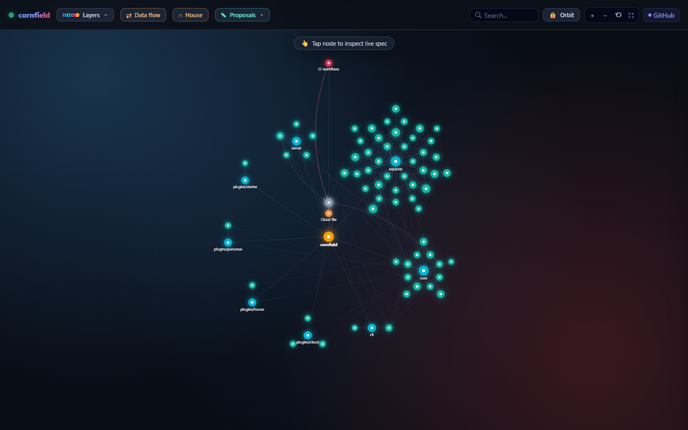
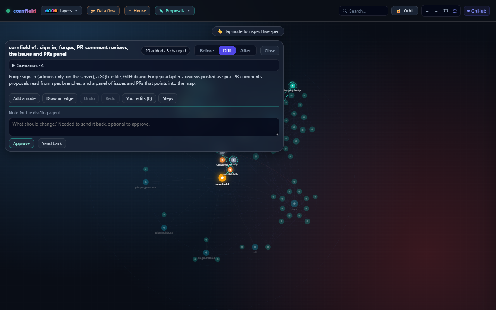
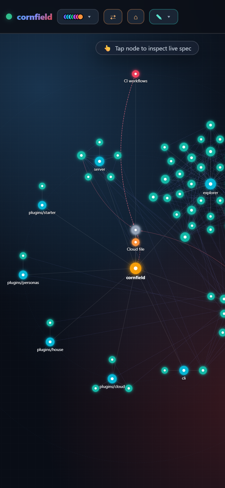

# cornfield

**The dev dashboard with the map at its centre.** cornfield draws your repo as a living topology map (packages, apps, pages, tables, services, stacks, machines and the cloud services you depend on) and keeps it true to the code. Changes are proposed *on the map* before anything is built: you see what a change adds, changes and removes, play its scenarios step by step, try what-if edits, and approve it or send it back.

It is one Node codebase with no build step and no runtime dependencies, shipped two ways: an npm CLI you run against a repo on your laptop, and a Docker image for an always-on dashboard.



*cornfield mapping itself: each folder is a package, each module a node, the lines are imports, and the grey nodes are the cloud services its code and CI reach.*

<p>
  
  
</p>

*Left: a proposal open on the map (Before / Diff / After, its scenarios, Approve or Send back). Right: the map on a phone.*

## Quick start

```sh
cd your-repo
npx cornfield sync        # derive topology.json from the code
npx cornfield validate    # schema, drift from the code, every proposal
npx cornfield serve       # the map on http://127.0.0.1:3350
```

No config is needed: the starter deriver maps any npm-workspaces repo, Go modules, Rust crates and Python packages (or, without any, each top-level folder with code). Add a `cornfield.config.js` when you want more (see [docs/config.md](docs/config.md)).

## Local, or behind sign-in

**Without sign-in, cornfield only listens on 127.0.0.1 and refuses any other address**: everything it serves (your map, your proposals) would be visible to anyone who could reach it. Open it on the machine it runs on, or reach it over an SSH tunnel:

```sh
ssh -L 3350:127.0.0.1:3350 you@the-machine
```

**With forge sign-in** (a GitHub or Forgejo OAuth app in env, and an https public URL) it may listen on any address behind a reverse proxy, and shows the dashboard to the repo's maintainers only, enforced on the server for every route. Setting it up: [docs/sign-in.md](docs/sign-in.md).

## What it does today

- **The map.** WebGL2 (Canvas 2D fallback), 5,000 nodes and 15,000 edges at frame rate. Orbit, data-flow and House views, layers, search, focus, freeform drag. `/?fixture=5k&bench=1` measures it. All of it works by keyboard, and a screen reader is told where you are: [docs/accessibility.md](docs/accessibility.md).
- **Derived, not drawn by hand.** `cornfield sync` runs the derivers named in your config and merges what they find into `topology.json`; hand-written parts (descriptions, flows, anything of a type no deriver owns) are kept. `cornfield validate` fails on drift, so CI keeps the map honest.
- **Proposals.** `docs/specs/proposals/NNNN-slug.json` says what a change would add, change and remove, with scenarios. cornfield lists them from your checkout and from every git worktree in the configured worktrees folder, and shows Before / Diff / After, the scenario player, what-if edits, and Approve / Send back. Writing, reviewing and landing one in your repo: [docs/proposals.md](docs/proposals.md). The format and its validator: [core/proposal.js](core/proposal.js).
- **Personas, not people.** `topology.personas.json` holds archetypes (Admin, Member, Guest); scenarios act as them, never as a real person.
- **The cloud you do not control.** `topology.cloud.json` describes the outside services; the cloud deriver's detectors (hosts in code, Dockerfiles, container images, CI workflows, a Caddyfile) keep it complete in both directions. "Cloudflare is down" plays as an outage: what breaks now, at the next deploy, at the next certificate renewal. [docs/cloud.md](docs/cloud.md).
- **The house, optional.** A House view of floors, rooms, devices, machines and people (as counts), read from a source: a JSON file in your repo, your own API, later Home Assistant. cornfield only displays it. [docs/house.md](docs/house.md).

## Run it always on

```sh
docker run -d --name cornfield --network host \
  -v "$PWD:/repo:ro" -v cornfield-data:/data ghcr.io/popcorn245/cornfield
```

[compose.example.yml](compose.example.yml) is the same as a compose service. Host networking is what keeps it on the host's loopback without sign-in.

## Commands

| Command | What it does |
|---|---|
| `cornfield serve` | the dashboard (`--port`, or `CORNFIELD_PORT`) |
| `cornfield sync` | derive the map from the code into `topology.json` |
| `cornfield validate` | schema, drift, the personas and cloud files, every proposal; exit 1 on a problem |
| `cornfield status` | what the map holds, the warnings, the validation |
| `cornfield proposal <file>` | one proposal against the map: its counts, errors and what has landed |
| `cornfield review <slug>` | the last review of a proposal (verdict, note, what-if edits) |
| `cornfield docs` | the docs as a static site, built from the map of their links (`--out`, default `_site`) |

Every command takes `--repo <dir>` and `--config <file>`.

## Extending it

- **Derivers** read your code and say which nodes and edges the map must hold: [docs/derivers.md](docs/derivers.md) (contract 1). Put your own code on the map (routes, jobs, queues) with a deriver of yours, and test it against a fixture repo with one import, `cornfield/deriver-kit`: [docs/deriver-kit.md](docs/deriver-kit.md).
- **Docs** are on the map too: the `docs` deriver maps each document and its links (to other docs and to the code), `validate` fails on a broken link, and `cornfield docs` builds them as a site ([docs/derivers.md](docs/derivers.md#the-docs-site)).
- **Sources** are browser modules for the live layer, the house, devices and permission checks: [docs/config.md](docs/config.md#sources).

## The plan

cornfield grows in the open. The vision: [docs/vision.md](docs/vision.md). The v1 spec and its issues: [docs/specs/0001-v1.md](docs/specs/0001-v1.md). Decisions: [docs/adr/](docs/adr/). After v1: [docs/roadmap.md](docs/roadmap.md). To propose a change, see [CONTRIBUTING.md](CONTRIBUTING.md): cornfield uses its own map for its own features.

## Licence

MIT, see [LICENSE](LICENSE).
