# The 0.34 design review

## Executive summary

- **What:** cornfield 0.34.0, reviewed as its one maintainer uses it: arriving from a link, reviewing a proposal on the map, approving or sending it back, following agent runs in the Work panel, and reading a big map.
- **How:** five reviewers, one area each (review flow, the map, the Work panel and states, the visual system and theme contract, accessibility). Each walked their area at 1440×900 and 390×844, in the light and dark levels, in the default theme and in a brand fixture theme ("retro"), on a map of 922 nodes and 3,632 edges, with the keyboard and the accessibility tree.
- **Found:** 60 findings, ranked by the PM. 5 block a task, 43 slow a task, 12 are polish. 56 have new issues (#152 to #207); the other 4 add evidence to existing ones (#148, #149, #150, #133).
- **Top five:** Approve posts at once with no guard ([F01](#f01)); 46 outside services sit on one point of the map ([F02](#f02)); scenarios and their personas are hidden behind Play ([F09](#f09)); the whole map cannot be seen at any zoom ([F22](#f22)); what is waiting on the maintainer is hidden ([F34](#f34), [F36](#f36)).
- **What holds up:** axe finds 0 violations in 8 combinations, map keys work as documented, focus traps work in most dialogs, bad links never crash, idle is quiet, and theme tokens reach nearly all of the chrome.

## How to read it

Findings are ranked by severity: **blocks a task** (the user cannot finish, or gets a wrong answer without knowing), **slows a task** (they finish, with extra steps, waiting or doubt), **polish** (it looks careless but costs no time). Each heading links to its GitHub issue, which has the full repro and a "done when" check.

## How to reproduce the rig

The review ran on a private map. Every screenshot here is re-shot on the synthetic big map, which has the same counts (922 nodes, 3,632 edges, 19 types) and the same shape. From the repo root:

```sh
node test/fixtures/big/serve.js --forge --port 3461                 # default theme, signed-in maintainer, a fake forge, runs in every state
node test/fixtures/big/serve.js --forge --theme retro --port 3462   # the same map in the retro brand theme
# open http://127.0.0.1:3461/auth/start once to sign in; spec PRs are #21 to #26:
#   /?proposal=0100-new-flow-across-apps&source=pull/21 ... /?proposal=0105-second-site&source=pull/26
```

See `test/fixtures/big/README.md` for the runner switch (`--runner offline|none`) and the signed-out sign-in page. The numbers below come from the reviewed map unless a line says "on the fixture". Where the fixture differs, the text says so.

Terms used below:
- **Proposal:** an agent's suggested change to the map, opened at `/?proposal=<slug>`.
- **Spec PR:** the pull request that carries a proposal; Approve and Send back post on it.
- **Diff, Before, After:** the three views of a proposal on the map.
- **What-if edit:** a change the reviewer tries on top of a proposal (the Edit button).
- **Scenario:** a walk across the map, step by step, that shows how a proposal behaves. A **persona** is who the scenario is for.
- **Run:** an agent's job; a **runner** is the process that picks runs up.
- **Level:** light or dark. **Brand theme:** a project's own look, set through `--corn-*` tokens and `data-corn` hooks (stable attributes a theme can style).
- **Hub:** a node with many children, such as an app.

## Findings: blocks a task

### <a id="f01"></a>F01 · [Approve posts at once on a draft PR with checks running, and drops an open what-if edit](https://github.com/popcorn245/CornField/issues/152)
- **Task:** deciding to approve a spec PR, knowing what will happen.
- **Where:** proposal bar · 1440 and 390 · light and dark · default and retro.
- **Evidence:** 1 click to post, 0 confirmations. Approve was live 16–25 ms after the bar showed, on a draft PR with a check still running. With an "Add a node" form open and its edit refused, the request went out with `edits: []`. Afterwards Approve stays enabled.

  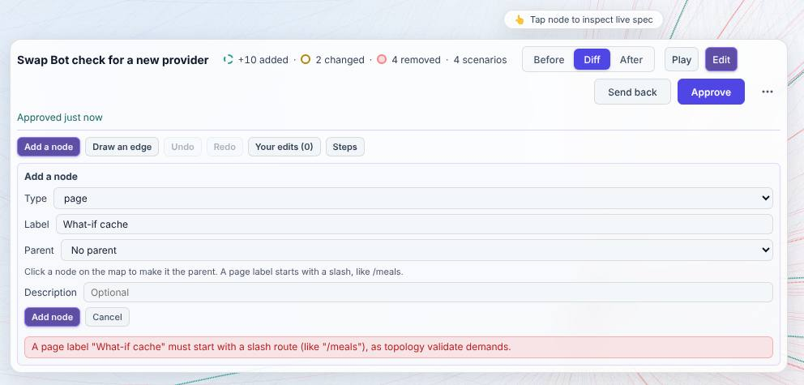
- **Fix:** say what Approve does next to it; on a draft or non-green PR, disable it with the reason or ask for a second press; ask when a what-if form holds input; after posting, show "Approved" with Undo.
- **Size:** M. **Route:** spec 0007.

### <a id="f02"></a>F02 · [All 46 cloud nodes sit on one point; a click reaches only the top one](https://github.com/popcorn245/CornField/issues/148)
- **Task:** finding which outside services the system depends on, and opening one.
- **Where:** map, orbit layout · 1440 and 390 · light and dark · default and retro.
- **Evidence:** 46 external nodes (45 cloud, 1 public web) at one point: 1,035 overlapping pairs, all < 0.5 px apart. With People on, 5 personas make a second pile (1,045 pairs, 51 nodes). No other discs overlap. On a phone, 41 externals have no tap area at any zoom. Cause: `layout.js` puts every child of a non-hub parent at the same spot. Reproduced on the fixture: one pile of 46 at the same point.

  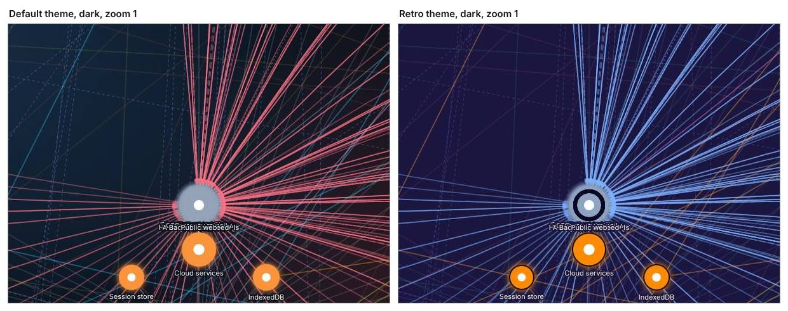
- **Fix:** give a non-hub parent's children their own ring (`ringPack`) and count it in the hub's extent; a unit test that no two nodes overlap.
- **Size:** M. **Route:** batch B (map).

### <a id="f03"></a>F03 · [A reply typed to a waiting run is garbled when the runs list refreshes](https://github.com/popcorn245/CornField/issues/153)
- **Task:** answering a waiting run from Work → Runs.
- **Where:** Work → Runs, reply field · 1440 and 390 · light and dark · default and retro.
- **Evidence:** the 60 s poll redraws the list; the caret goes from [4,10] to [0,0], so text typed next goes to the front. Reproduced on the fixture: "Keep the old page " then, after one poll, "until Friday." leaves `until Friday.Keep the old page `.

  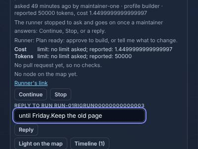
- **Fix:** keep selection and scroll of a focused reply field; do not redraw unchanged run cards; skip the repaint while a reply has focus.
- **Size:** S. **Route:** batch C (Work panel and states).

### <a id="f04"></a>F04 · [A failed review read is silent, so an approved spec looks unreviewed](https://github.com/popcorn245/CornField/issues/154)
- **Task:** arriving cold at a spec PR to see whether it was already approved.
- **Where:** proposal bar · 1440 and 390 · light and dark · default and retro.
- **Evidence:** with the review read answering, the bar says "Approved 1 hour ago"; with it answering 500, the bar shows nothing and looks unreviewed. `loadReview` returns silently on any error.

  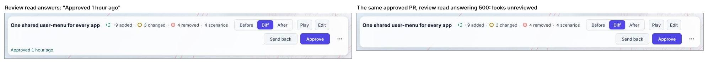
- **Fix:** "Could not read past reviews. [Try again]".
- **Size:** S. **Route:** batch C.

### <a id="f05"></a>F05 · [Review tokens dialog: "Kind of token" cannot be reached from the keyboard](https://github.com/popcorn245/CornField/issues/155)
- **Task:** making an agent token without a mouse.
- **Where:** Review tokens dialog · 1440 and 390 · light and dark · default and retro.
- **Evidence:** Tab cycles Label → Days → Make a token → Close → Label: 4 of 5 stops; the `<select>` is never reached. The trap's selector (`review-tokens.js:182`) lists only buttons and inputs. Reproduced on the fixture with the same order.

  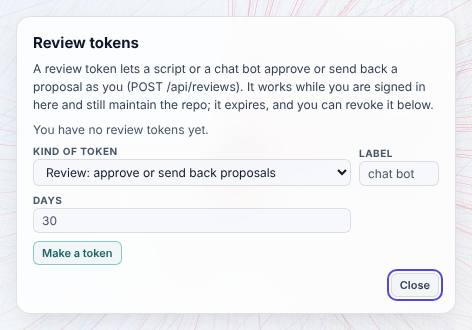
- **Fix:** add `select` and `textarea` to the trap; share one focus helper with the Start-a-run dialog.
- **Size:** S. **Route:** batch D (accessibility).

## Findings: slows a task

### Reviewing a proposal

#### <a id="f06"></a>F06 · [Opening a proposal frames the whole map; on a phone no changed node is on screen](https://github.com/popcorn245/CornField/issues/156)
- **Where:** map on open · 1440 and 390 · light and dark · default and retro.
- **Evidence:** zoom 0.18 (the floor) on every open. Changed nodes on screen, 1440 / 390: 5/9 and 0/9 (0100), 2/7 and 0/7 (0101), 1/8 and 0/8 (0102). At 390, 0 changed nodes in view for 4 of 8 proposals. The 190 px bar is not allowed for. On the fixture it is worse: 0 of 9 at both widths.

  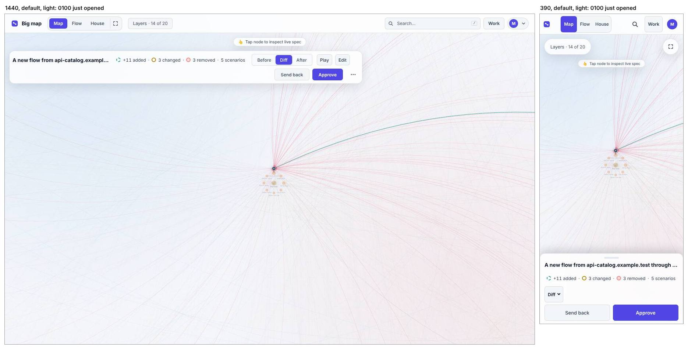
- **Fix:** fit to the touched nodes only, minus the area under the bar or sheet, zooming in up to 1.0.
- **Size:** S. **Route:** batch A (review flow).

#### <a id="f07"></a>F07 · [Choosing a change in the list centres the node underneath the list](https://github.com/popcorn245/CornField/issues/157)
- **Where:** change list · 1440 · light and dark · default and retro.
- **Evidence:** every row lands at screen (720, 476), inside the list box (x 13–947, y 100–578); zoom stays 0.18. Reproduced on the fixture: the picked node is under the list.

  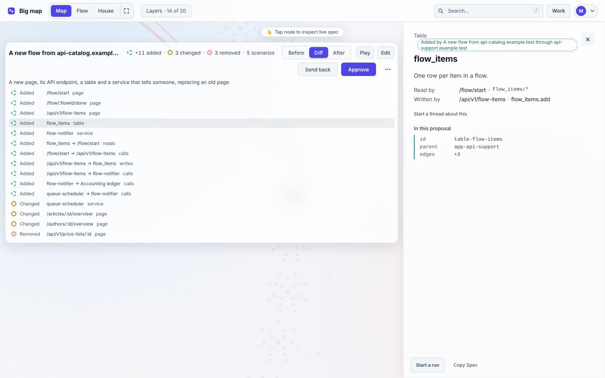
- **Fix:** centre in the free area, zoom to at least label zoom, pulse the node.
- **Size:** S. **Route:** batch A.

#### F08 · [The proposal bar never says which copy you review: PR number, draft or open, checks](https://github.com/popcorn245/CornField/issues/158)
- **Where:** proposal bar · 1440 and 390 · light and dark · default and retro.
- **Evidence:** bar text from `?source=pull/21`: title, counts, Diff, Send back, Approve. No PR number, state or checks. The checkout copy and the PR copy look the same.
- **Fix:** a source chip: "PR #21 · Open · checks 1 of 2 running", or "Draft in the checkout".
- **Size:** M. **Route:** batch A.

#### <a id="f09"></a>F09 · [Scenarios sit behind Play, and nothing says who a scenario is for](https://github.com/popcorn245/CornField/issues/149)
- **Where:** Play list and scenario player · 1440 and 390 · light and dark · default and retro.
- **Evidence:** "5 scenarios" opens the change list, not the scenarios. List rows say "<title> · N steps" with no persona. Scenarios naming a persona: 1 of 5 in 0100 and 0101, 0 of 4 in 0102 to 0105, none in the 64 small ones. Clicks to the list: 1 at 1440, 2 at 390. Knowing who a scenario is for is not possible from the list.

  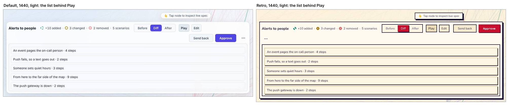
- **Fix:** a Scenarios panel beside the change list, grouped by persona, each row saying which changes it walks through.
- **Size:** L. **Route:** spec 0006.

#### F10 · [Scenario walk: the camera never zooms in, step labels are 4px, steps go off screen](https://github.com/popcorn245/CornField/issues/159)
- **Where:** scenario player and map · 1440 and 390 · light and dark · default and retro.
- **Evidence:** zoom 0.18 at all 11 steps of the long walk; the step's label about 4.5 px tall; at step 6 one edge end at y −210 and the other behind the 133 px player. On the fixture (9 steps), step 7's node sits at y −706, off screen.

  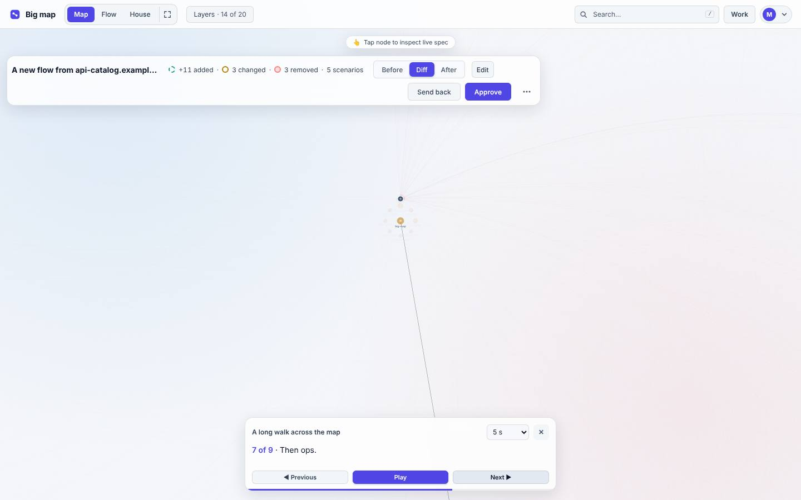
- **Fix:** zoom in to label zoom for a node step, fit both ends for an edge step, minus the bar and player.
- **Size:** S. **Route:** batch A.

#### F11 · [Phone: the scenario player opens as a peek with no controls](https://github.com/popcorn245/CornField/issues/160)
- **Where:** player sheet · 390 · light and dark · default and retro.
- **Evidence:** Previous, Pause and Next are not visible until the player is expanded. The two sheets take y 559–844 (285 px). Stepping back takes 5 taps.

  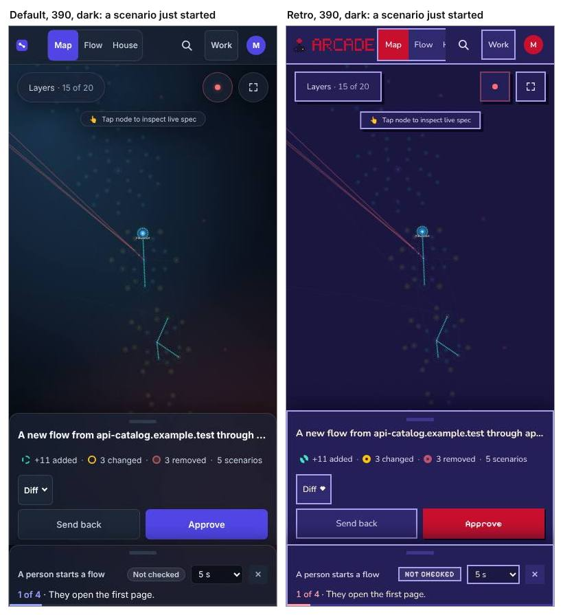
- **Fix:** fold the proposal sheet while a scenario plays; ◀ ⏯ ▶ in one 44 px row in the peek.
- **Size:** S. **Route:** batch A.

#### F12 · [Focus falls to the page after Approve, Send back, a scenario, and Stop](https://github.com/popcorn245/CornField/issues/161)
- **Where:** proposal bar, player, Work → Runs · 1440 and 390 · light and dark · default and retro.
- **Evidence:** focus lands on `body` after all five actions. A cold Tab from `body` reaches the toolbar at stop 11. After opening the change list or Play's list, the next Tab goes to Before or Edit, not into the list.
- **Fix:** focus the status line, the player, or the run card; move focus into lists that open.
- **Size:** M. **Route:** batch A (the Stop part: batch C).

#### F13 · [No way to read a scenario's steps as a list, and no full non-visual review path](https://github.com/popcorn245/CornField/issues/162)
- **Where:** proposal bar, lists, node panel · 1440 and 390 · light and dark · default and retro.
- **Evidence:** change list: 15 bare buttons, 0 list items. Scenario list: 5, 0 list items. Proposal name is `strong`, not a heading. Steps exist as a list only as editable textboxes under Edit. Verdicts show one step at a time.
- **Fix:** a read-only Steps list per scenario, with verdicts; lists under headings; an `h2` title; a was / now diff in the node panel.
- **Size:** M. **Route:** spec 0006.

#### F14 · [Phone with the keyboard up: "Send back with this note" is off screen](https://github.com/popcorn245/CornField/issues/163)
- **Where:** proposal sheet · 390×500 · light and dark · default and retro.
- **Evidence:** note y 410–458, Cancel 464–508, Send and Approve 514–558 (retro 520–564) in a 500 px viewport. Reproduced on the fixture with the same boxes.

  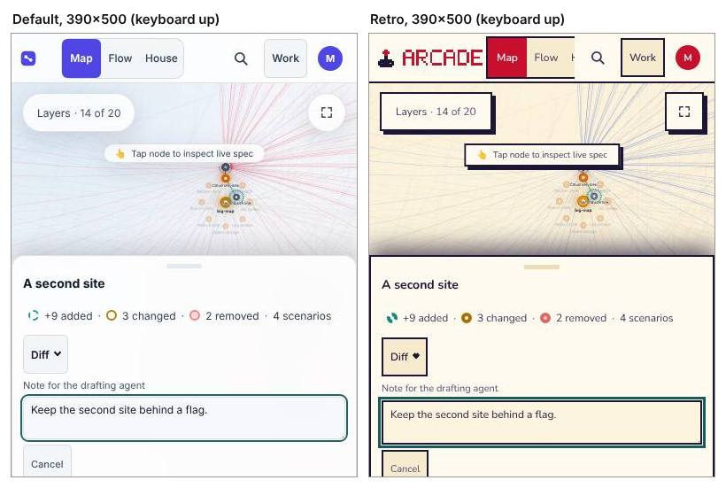
- **Fix:** Send and Cancel in one row under the field; hide Approve while the note is open.
- **Size:** S. **Route:** batch A.

#### F15 · [Phone: a disabled Approve gives no reason](https://github.com/popcorn245/CornField/issues/164)
- **Where:** proposal sheet peek · 390 · light and dark · default and retro.
- **Evidence:** the explanation line is visible at 1440, hidden at 390, also after tapping the greyed button.
- **Fix:** show the reason in the peek.
- **Size:** S. **Route:** batch A.

#### F16 · [A bad proposal link shows one red line and no way on](https://github.com/popcorn245/CornField/issues/165)
- **Where:** proposal bar message · 1440 and 390 · light · default.
- **Evidence:** four kinds of bad link give the same line; `source=garbage` is echoed. The right PR is card 66 of 77 in Specs.
- **Fix:** offer the right copy, or the Specs list; sort spec PRs first.
- **Size:** S. **Route:** batch A.

#### F17 · [What-if: a new node lands off screen, counts ignore it, no "as written" view](https://github.com/popcorn245/CornField/issues/166)
- **Where:** what-if toolbar and map · 1440 · dark · default.
- **Evidence:** new node at canvas (1033, −23), no camera move; counts unchanged ("+9 added · 3 changed · 4 removed"); the only way back to the proposal as written is to undo each edit.
- **Fix:** bring the node into view; "+1 yours" in the counts; an "As written / With my edits" switch.
- **Size:** M. **Route:** spec 0007.

#### F18 · [Opening a proposal, Before/Diff/After, undo and pause announce nothing](https://github.com/popcorn245/CornField/issues/167)
- **Where:** proposal bar and map · 1440 and 390 · light and dark · default and retro.
- **Evidence:** live regions polled every 100 ms: on load only "Opening <slug> …"; Before, After, Diff, a change row, Space and Ctrl+Z: nothing within 1 s.
- **Fix:** announce load (title and counts), each view switch, undo and redo, pause and play, and a change row.
- **Size:** S. **Route:** batch D.

#### F19 · [The "removed" mark is under 3:1 in every theme; light marks barely reach 3:1](https://github.com/popcorn245/CornField/issues/168)
- **Where:** map, Diff view · 1440 and 390 · light and dark · default and retro.
- **Evidence:** removed mark (alpha 0.55): 1.93 / 2.74 / 1.93 / 2.71:1 (default light, default dark, retro light, retro dark). Light added / changed / edit: 3.08 / 3.09 / 3.09:1 on the median ground, 2.77:1 on the darkest.
- **Fix:** full-alpha removed mark with a cross or dash; deeper light marks (≥ 3.5:1); a contrast check in `validate`.
- **Size:** S. **Route:** batch D.

#### F20 · [A what-if edit and a proposal's change look the same without colour](https://github.com/popcorn245/CornField/issues/169)
- **Where:** map, Edit on · 1440 and 390 · light · default and retro.
- **Evidence:** both are a solid 2.5 px ring 9 px out; light colours have equal luminance (ratio 1.00:1; 1.63:1 in dark).
- **Fix:** give the edit mark its own shape.
- **Size:** S. **Route:** batch D.

#### F21 · [At 400% zoom or with wider text spacing, the proposal sheet scrolls both ways](https://github.com/popcorn245/CornField/issues/170)
- **Where:** proposal sheet, node panel title · 390 and 360×225 · light and dark · default and retro.
- **Evidence:** at 360×225 the sheet box is 358×112 with 374×785 of content; with text spacing at 390 the counts chip is 442 px wide ("5 sce"); the node title shows 275 of 330 px.
- **Fix:** let the counts and title wrap; let the sheet go full height with the note open.
- **Size:** S. **Route:** batch A.

### Reading the map

#### <a id="f22"></a>F22 · [The first view shows part of the map with 4px labels, and you cannot zoom out to all of it](https://github.com/popcorn245/CornField/issues/171)
- **Where:** map camera · 1440 and 390 · light and dark · default and retro.
- **Evidence:** the layout is 9,178 × 9,174 px; showing it all needs zoom 0.082 at 1440 and 0.037 at 390. Fit stops at 0.18, hand zoom at 0.25, and the wheel turned out from Fit goes to 0.25 (zooms in) three times out of three. First view at 1440: 386 nodes, 30 labels at 4.3–4.7 px. On the fixture the layout is larger (needs 0.066 at 1440), and the first view shows only the small core in the middle; the wheel-out gave 0.25 three times.

  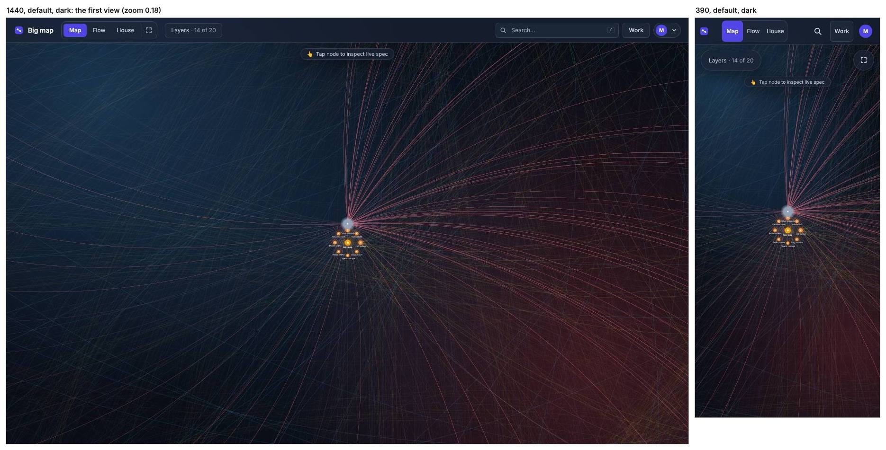
- **Fix:** let the zoom floor follow the map's size; size the hub ring by the clusters' real need.
- **Size:** S. **Route:** batch B.

#### F23 · [Between zoom 0.25 and 0.6 almost nothing is labelled; dimmed labels are under 2.5:1](https://github.com/popcorn245/CornField/issues/172)
- **Where:** label layer · 1440 and 390 · light and dark · default and retro.
- **Evidence:** in the largest cluster: 18 labels for 489 nodes at 0.25; 2 for 297 at 0.5; 112 for 97 at 1, with 8 colliding pairs. Label sizes 4.3 / 6 / 9 / 11–12 px at 0.18 / 0.25 / 0.5 / 1. In the Diff view 815 of 827 labels are drawn at alpha 0.28: 1.82 / 2.47 / 1.83 / 2.36:1. Full labels are fine (≥ 13.8:1).

  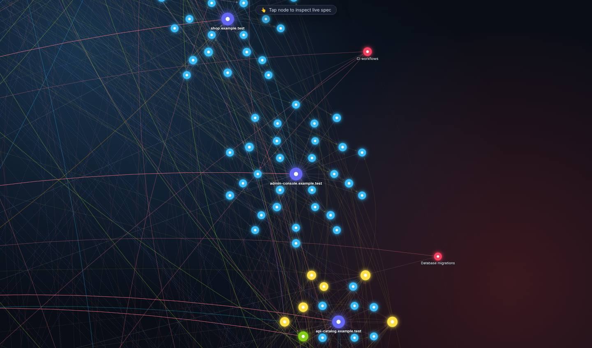
- **Fix:** a minimum label size, a declutter pass by priority, cluster titles at low zoom; dimmed labels at about alpha 0.6.
- **Size:** M. **Route:** spec 0008 (dimmed-label contrast: batch D).

#### F24 · [Search shows no count or list, cannot step through matches, and is silent on no match](https://github.com/popcorn245/CornField/issues/173)
- **Where:** header search · 1440 and 390 · light and dark · default and retro.
- **Evidence:** a 4-letter term: 33 matches, 28 on screen, zoom stays 0.18, 0 list items; Enter twice selects the same node; no visible "no match". 4 of 58 service labels contain their kind's word. On the fixture a 4-letter term matched 31 nodes, 5 on screen.

  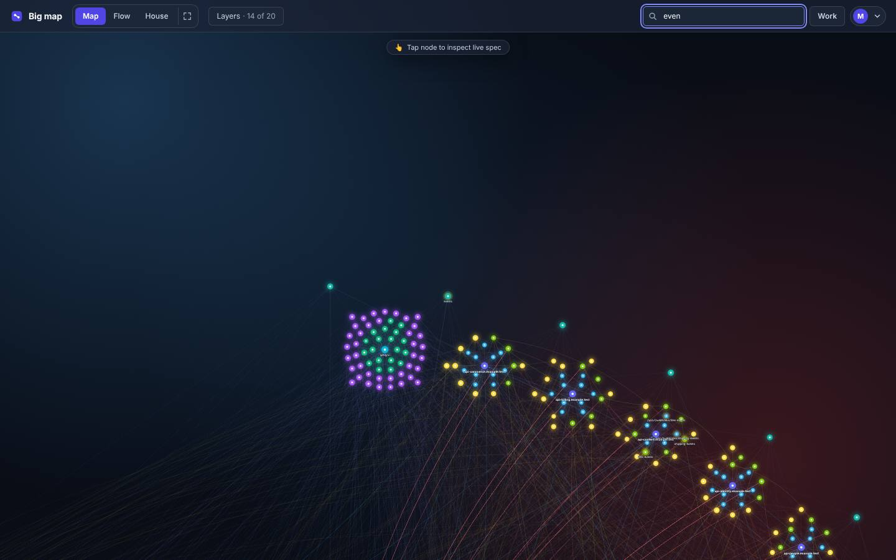
- **Fix:** "n of N" in the field, Enter steps and flies to the match, a results list, "No matches" shown and announced, match on kind and path.
- **Size:** M. **Route:** spec 0008 (the no-match message: batch B).

#### F25 · [Selecting a hub lights most of the map; a selection's neighbours stay off screen](https://github.com/popcorn245/CornField/issues/174)
- **Where:** focus subgraph and selection · 1440 and 390 · light and dark · default and retro.
- **Evidence:** lit nodes / glowing edges: root 694 / 908, largest app 515 / 1,590, a busy service 27 / 30, a page 4 / 3. Selection never moves the camera. On the fixture the root lights all 922 nodes and 1,617 edges; a page lights 6.

  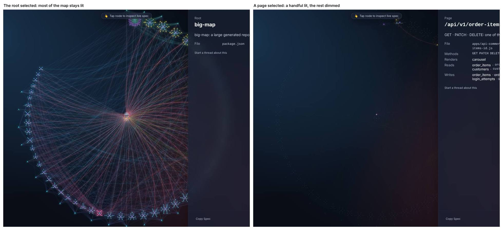
- **Fix:** light one hop plus children; "show paths through" as a toggle; fit the camera to the lit set.
- **Size:** M. **Route:** spec 0008.

#### F26 · [A timer, a webhook and a job look the same everywhere but one panel row](https://github.com/popcorn245/CornField/issues/175)
- **Where:** map, legend, panel, search · 1440 and 390 · light and dark · default and retro.
- **Evidence:** 58 services in 8 kinds (21 job, 16 client, 8 dispatch, 7 hook, 2 webhook, 2 timer, 1 effects, 1 scheduler); one fill and one icon for all. Cloud and Public web share a colour (ΔE2000 = 0; ΔE2000 is the standard measure of how different two colours look, and under about 10 they are easy to confuse).
- **Fix:** a kind glyph in the node core, legend rows per kind, "Service · timer" in the badge, `--corn-map-node-<type>-<kind>` tokens.
- **Size:** M. **Route:** spec 0009.

#### F27 · [A project cannot add its own layers](https://github.com/popcorn245/CornField/issues/150)
- **Where:** `layers.js`, `state.js`, `scene.js`, `core/config.js`.
- **Evidence:** 20 hard-coded layer rows keyed by type; `layers` in the config is refused as an unknown key.
- **Fix:** a data-only `layers: { add, hide, off, order }` key with `match` by type, kind, group, parent or field.
- **Size:** M. **Route:** spec 0009.

#### F28 · [Edge kinds differ by colour alone, and a dashed line means three things](https://github.com/popcorn245/CornField/issues/176)
- **Where:** edges and the Layers legend · 1440 and 390 · light and dark · default and retro.
- **Evidence:** six edge kinds share one 1.6 px line and arrowhead. Dashes mean usage [4,4], proposed [7,5] and "breaks at the next deploy" [9,5]; 90 calls on this map are deploy-dashed.
- **Fix:** dash for "proposed" only; a marker for `when`; arrowhead shapes per kind; kind labels on lit edges.
- **Size:** M. **Route:** spec 0008.

#### F29 · [Several node types are near-identical colours on circles of near-identical size](https://github.com/popcorn245/CornField/issues/177)
- **Where:** node fills · 1440 and 390 · light and dark · default and retro.
- **Evidence:** ΔE2000 under 13: cloud/web 0.0, page/pkg 9.3, root/store 9.4, core/atom 10.7, app/molecule 12.1 (default dark); app/molecule 9.3 (retro dark). Nodes are 6–9 px across at the first view.
- **Fix:** a second channel per type (glyph or ring style); separate the closest pairs.
- **Size:** M. **Route:** spec 0008.

#### F30 · [Tapping a node is slow, and on the Canvas 2D fallback on a phone it takes 33s](https://github.com/popcorn245/CornField/issues/178)
- **Where:** renderer · 390 · dark · default and retro.
- **Evidence:** Canvas 2D (the renderer for devices without WebGL2), 390, DPR 3, 4× CPU throttle: root tap → panel 33.3–34.9 s; unthrottled 8.4–10.6 s. Build and draw issuance are 20–66 ms, so the time is in shadow-blur glow on about 900 edges.
- **Fix:** no `shadowBlur` for edge glow; cap glowing edges.
- **Size:** S. **Route:** batch B.

#### F31 · [First load is 2.2MB, sent uncompressed, in 74 requests](https://github.com/popcorn245/CornField/issues/179)
- **Where:** server static files · any.
- **Evidence:** 74 requests, 2,263 KB; `topology.json` 1,095 KB gzips to 140 KB; no `Content-Encoding`; everything `no-cache`.
- **Fix:** gzip or brotli for `.js`, `.css`, `.json`.
- **Size:** S. **Route:** batch B.

#### F32 · [Phone: the expanded node sheet hides the selected node, and most nodes are too small to tap](https://github.com/popcorn245/CornField/issues/180)
- **Where:** node sheet and hit test · 390 · light and dark · default and retro.
- **Evidence:** expanded sheet top y 338, selected node y ≈ 446. Touch tap area at zoom 0.18: median about 9×9 px, 690 of 824 under 44×44, 365 with none.
- **Fix:** pan the node into the uncovered band on expand; open phone views at a tappable zoom.
- **Size:** S. **Route:** batch B.

#### F33 · [A household reader's first screen is a developer tool](https://github.com/popcorn245/CornField/issues/181)
- **Where:** sign-in page and first screen · 1440 and 390 · light and dark · default and retro.
- **Evidence:** the sign-in page says "This is the dev dashboard"; without sign-in, the first view is zoom 0.18 with 4 px labels and the hint "Tap node to inspect live spec"; the node panel leads with file paths and code.
- **Fix:** plain words on the sign-in page and hint; description first in the panel.
- **Size:** S. **Route:** batch E (words on the sign-in page).

### The Work panel, feedback and state

#### <a id="f34"></a>F34 · ["Waiting on you" looks like every other run state, and nothing else says a run waits](https://github.com/popcorn245/CornField/issues/182)
- **Where:** Work → Runs, header Work button, proposal bar · 1440 and 390 · light and dark · default and retro.
- **Evidence:** Requested, Claimed, Working, Waiting and Stopped pills are all `rgb(252,211,77)` in default dark; 5 of 7 identical in greyscale. No badge on Work; nothing on the proposal the run asks about. 3 clicks and a scroll to Continue. Reproduced on the fixture in both themes. In retro, "LOCAL" reads "LOOAL" in the 10 px pixel face.

  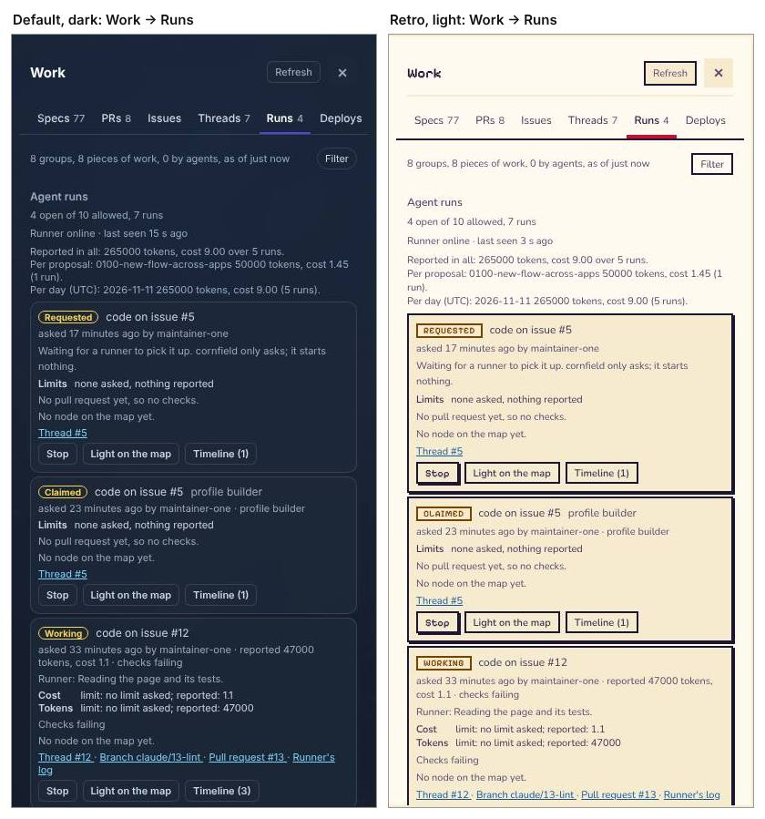
- **Fix:** a tone and a glyph per state (batch C); later, "1 waiting on you" on the Runs tab, a dot on Work, and a line on the proposal bar (spec 0010).
- **Size:** M. **Route:** batch C (states told apart without colour); spec 0010 (surfacing it).

#### F35 · ["No runner online" is a faint line in the Runs tab; Approve says nothing](https://github.com/popcorn245/CornField/issues/183)
- **Where:** Runs, Start dialog, proposal bar · 1440 and 390 · light and dark · default and retro.
- **Evidence:** runner offline or none: the review page's text never mentions the runner; the line is 11 px meta text.
- **Fix:** a warn notice on every Work tab, a dot on Work, a line next to Approve.
- **Size:** M. **Route:** spec 0007.

#### <a id="f36"></a>F36 · [Specs waiting on the maintainer sit at the bottom of a 77-row list with no filter](https://github.com/popcorn245/CornField/issues/184)
- **Where:** Work → Specs · 1440 and 390 · light and dark · default and retro.
- **Evidence:** 77 rows for 71 proposals; the first rich spec PR at row 66, y 6,250 px of 7,308 (8.6 screens). No filter or search on Specs. On the fixture: row 67, y 6,233 of 7,343, and each rich proposal is listed twice.

  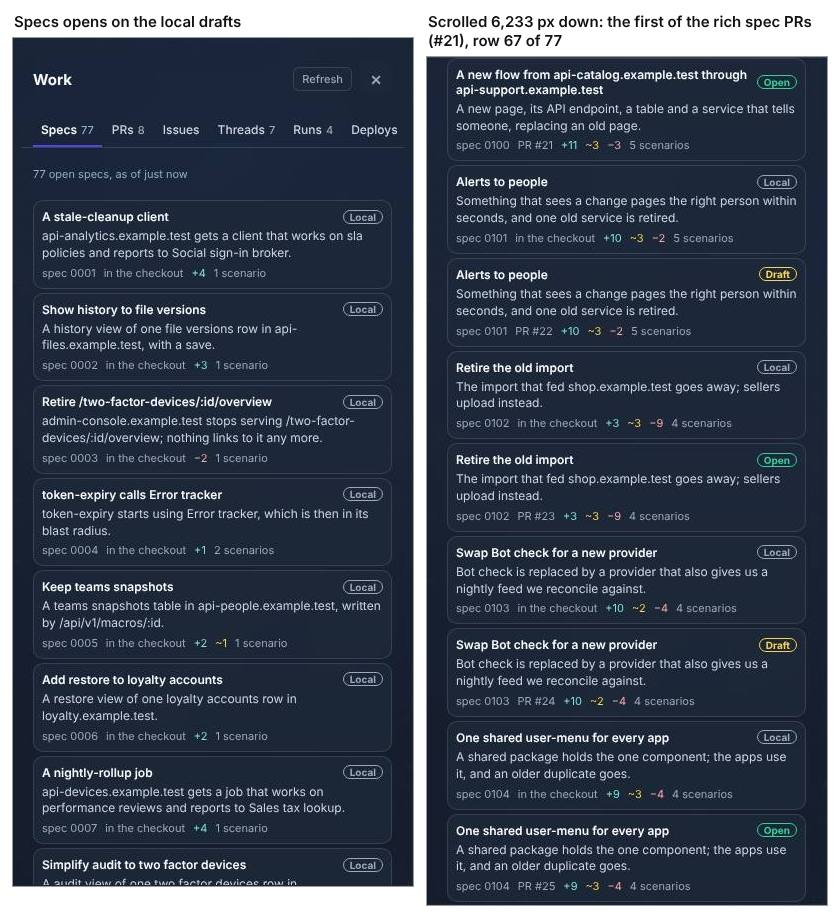
- **Fix:** group into "Waiting on you", "Sent back / approved", "Drafts"; one row per proposal; filter and search.
- **Size:** M. **Route:** spec 0010 (the double listing and count: batch C).

#### F37 · [Error lines are not plain, offer no Retry, and one reads as success](https://github.com/popcorn245/CornField/issues/185)
- **Where:** Work panel and proposal bar · 1440 and 390 · light and dark · default and retro.
- **Evidence:** "cornfield answered 200 for the forge." on malformed JSON; a raw parser message on Specs; "GitHub has no the issues of …"; no Retry anywhere in the panel.
- **Fix:** plain sentences per status, Retry on every error line, name the proposal.
- **Size:** S. **Route:** batch C.

#### F38 · [Offline is never said, and failures blame the server](https://github.com/popcorn245/CornField/issues/186)
- **Where:** whole app · 1440 and 390 · light and dark · default and retro.
- **Evidence:** offline: no change on screen; "Failed to fetch"; the same line after Approve; Work advises a refresh that would lose the note.
- **Fix:** an offline banner; name the failed action.
- **Size:** S. **Route:** batch C.

#### F39 · [Results of Reply, Continue and Stop land off screen; Copy Spec shows 1.5s](https://github.com/popcorn245/CornField/issues/187)
- **Where:** Runs; node panel · 1440 and 390 · light and dark · default and retro.
- **Evidence:** Reply at y 494 puts its result at y −498. Copy Spec's result shows for 1,500 ms and is not announced.
- **Fix:** results inside the run's card; announce Copy Spec.
- **Size:** S. **Route:** batch C.

#### F40 · [Run cost and tokens are raw floats with no unit](https://github.com/popcorn245/CornField/issues/188)
- **Where:** Runs cards, PR detail · 1440 and 390 · light and dark · default and retro.
- **Evidence:** "1.4499999999999997", "1.7999999999999998"; "47000 tokens". Reproduced on the fixture (see F03's picture).
- **Fix:** two decimals and a unit; grouped token counts.
- **Size:** S. **Route:** batch C.

#### F41 · ["Can't land yet" says why but not what to do; Land shows on an unapproved spec](https://github.com/popcorn245/CornField/issues/189)
- **Where:** PR detail · 1440 and 390 · light and dark · default and retro.
- **Evidence:** reason in 11 px `rgb(154,169,188)`; "Land it" enabled on a spec PR with "No approval yet".
- **Fix:** a next step per reason; warn on an unapproved spec.
- **Size:** S. **Route:** batch C.

#### F42 · [Phone: Deploys is hidden off the Work tab strip, and the panel header scrolls away](https://github.com/popcorn245/CornField/issues/190)
- **Where:** Work sheet · 390 (tabs), 1440 (header) · light and dark · default and retro.
- **Evidence:** 477 px of tabs in 380 px; Deploys at x 397–470; no fade. The header scrolls away with the list. (Visible in F45's picture.)
- **Fix:** sticky header and tabs; an overflow fade.
- **Size:** S. **Route:** batch C.

#### F43 · [Runs are spoken as a 26-character id; "Light on the map" fails label-in-name](https://github.com/popcorn245/CornField/issues/191)
- **Where:** Runs, map announcer · 1440 and 390 · light and dark · default.
- **Evidence:** `button "Light the nodes of run-01… on the map": Light on the map`; 7 of 22 run buttons are disabled but styled like enabled ones.
- **Fix:** name runs by their card title; start names with the visible label; a disabled style.
- **Size:** S. **Route:** batch C.

#### F44 · [Loading is a single faint line, and empty lists do not say what would fill them](https://github.com/popcorn245/CornField/issues/192)
- **Where:** Work tabs, PR detail · 1440 and 390 · light and dark · default and retro.
- **Evidence:** one 11 px loading line; lists jump 0 → 577 px (PRs), 0 → 7,066 px (Specs); "No pull requests here."
- **Fix:** skeleton rows; reserved count width; empty copy per tab.
- **Size:** S. **Route:** batch C.

### Chrome and phone

#### F45 · [Phone: opening Work during a review leaves a 90px strip of map, covered by chips](https://github.com/popcorn245/CornField/issues/193)
- **Where:** bottom sheets · 390 · light and dark · default and retro.
- **Evidence:** map area: proposal + Work 90 px (10.6%), retro 87 px; Layers, Fit and the hint fill it. Reproduced on the fixture: 90 px default, 87 px retro.

  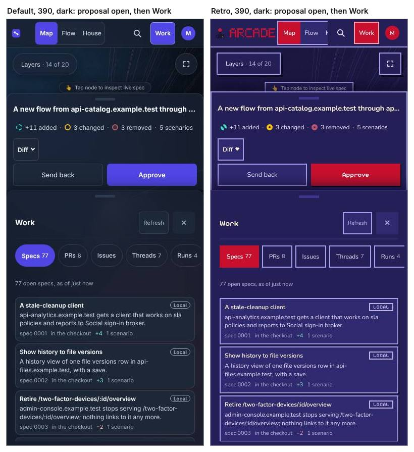
- **Fix:** open Work at peek over another sheet, or fold the proposal sheet; hide the hint.
- **Size:** M. **Route:** spec 0010.

#### F46 · [A brand wordmark pushes House off a phone's header, behind a hidden scroll](https://github.com/popcorn245/CornField/issues/194)
- **Where:** header · 390 · light and dark · retro.
- **Evidence:** brand button 120 px (default 44); header left 271 px of content in 228; House shows 10 of 47 px. Reproduced on the fixture with the same numbers.

  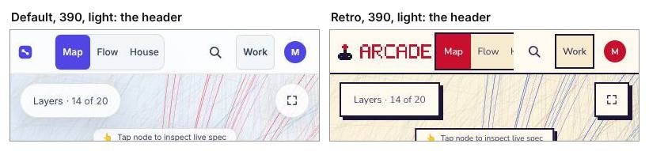
- **Fix:** logo only on a phone, or a capped brand width; an overflow fade.
- **Size:** S. **Route:** batch E (theme contract and chrome).

#### F47 · [House on a map with no house file shows a plan anyway, labelled two ways, with a red chip](https://github.com/popcorn245/CornField/issues/195)
- **Where:** House view · 1440 and 390 · light and dark · default and retro.
- **Evidence:** "No plan" on the map and a red-dot "Default plan, live layer unavailable" in the header, at once.
- **Fix:** one empty state with no error tone; a neutral live chip.
- **Size:** S. **Route:** batch E.

#### F48 · [`validate` says "Valid" while a brand's map colours fail contrast](https://github.com/popcorn245/CornField/issues/196)
- **Where:** `cornfield validate` · light · retro.
- **Evidence:** exit 0, no contrast line; retro light fills on cream 1.49–2.73:1 for 10 of 21 kinds; no `--corn-map-*` pairs checked.
- **Fix:** check map node, group and label tokens; print a pair count.
- **Size:** M. **Route:** batch E.

## Findings: polish, and the theme contract

### F49 · [The default theme shows through a flat brand: panel edges, sheet shadows, scrim, caret](https://github.com/popcorn245/CornField/issues/197)
- **Where:** panels, sheets, dialogs, header · 1440 and 390 · light and dark · retro.
- **Evidence:** the node panel's edge is `--corn-surface-2` (on the fixture: 2 px `rgb(247,235,207)` in retro) beside a bar with an ink edge; phone sheets keep a `0 -8px 24px` blur; the scrim ignores `--corn-scrim`; the avatar stays round; the phone mode caret draws a heart at retro's 4 px border (visible in F11, F14 and F45's pictures).

  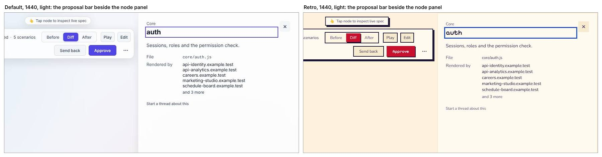
- **Fix:** panels use `--corn-line`; `--corn-shadow-sheet`; `--corn-scrim`; `--corn-radius-avatar`; an SVG caret.
- **Size:** S. **Route:** batch E.

### F50 · [The sign-in page wears neither brand nor theme, ignores Light/Dark, and does not say what the link was for](https://github.com/popcorn245/CornField/issues/133)
- **Where:** `/auth/sign-in` · 1440 and 390 · light and dark · default and retro.
- **Evidence:** pixel-identical in default and retro in all four width and level pairs; inline style, 0 `data-corn` hooks. Reproduced on the fixture.

  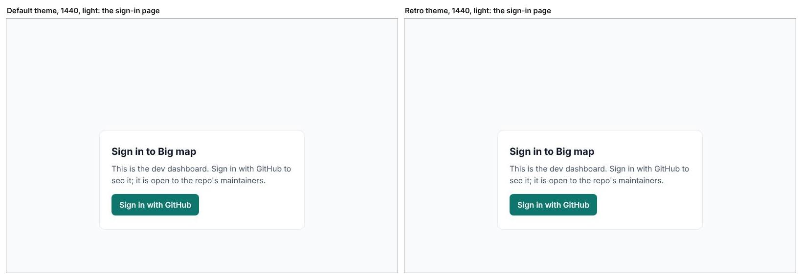
- **Fix:** the explorer's head on auth pages (tokens, theme, brand); "After you sign in: the proposal … on PR #21".
- **Size:** M. **Route:** batch E.

### F51 · [A brand cannot aim its fonts or its map: no number, button or map font tokens](https://github.com/popcorn245/CornField/issues/198)
- **Where:** proposal bar, Runs, PR detail, map · 1440 and 390 · light and dark · retro.
- **Evidence:** Approve in `"Pixelify Sans" 12px/600` beside Send back, Play and Edit in `Nunito 12px/500` (reproduced on the fixture). Retro had to set `--corn-mono` to a sans face to keep digits readable. Weights 500 and 650 are not loaded. Map labels use a fixed font stack.

  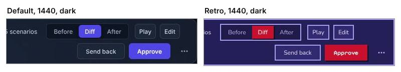
- **Fix:** a kind on every button; `--corn-font-numeric`, `--corn-font-button`, `--corn-map-font` and map line tokens.
- **Size:** M. **Route:** batch E.

### F52 · [`data-corn` hooks are missing on most of what 0.29 to 0.34 added](https://github.com/popcorn245/CornField/issues/199)
- **Where:** header, account menu, proposal bar, Work panel, node panel · 1440 · dark · default.
- **Evidence:** a DOM walk found about 20 kinds of element with no hook (Before / Diff / After, the Filter chip, counts, node chips, the "and N more" button, the sign-in page, and more).
- **Fix:** add and document the hooks, after batches A to D merge.
- **Size:** S. **Route:** batch E (second pass).

### F53 · [The visual system is a scatter: 22 type styles, 29 paddings, 3 toolbar heights](https://github.com/popcorn245/CornField/issues/200)
- **Where:** all chrome · 1440 and 390 · light and dark · default and retro.
- **Evidence:** 22 type styles (24 retro); panel titles 14/650, 15/700, 15/700, 20/650; 29 paddings, 11 gaps; toolbar controls 26, 30, 32 px; the bar wraps to 90 px at 1440.
- **Fix:** one panel head, one control height per density, one label style.
- **Size:** M. **Route:** filed, not scheduled.

### F54 · [Focus rings are cut off on Work tabs and on rows at the scroll edge](https://github.com/popcorn245/CornField/issues/201)
- **Where:** Work panel · 1440 · light and dark · default and retro.
- **Evidence:** Deploys ring clipped (default); all six tabs (retro); 9 of 60 rows per pass. On the fixture the default Deploys ring box runs to x 393 in a strip that ends at 391, so its right edge is cut; at 1× this does not read in a picture, so none is included. The retro clip was not clearly reproduced on the fixture.
- **Fix:** padding and `scroll-padding` the size of the ring; a `--corn-focus-offset` token.
- **Size:** S. **Route:** batch E.

### F55 · [Under reduced motion the side panels still slide](https://github.com/popcorn245/CornField/issues/202)
- **Evidence:** the Work panel slides 400 px in 206 ms with motion reduced (204 ms without). 1440 · both levels · both themes.
- **Fix:** `transition: none` for `.hx-drawer`, `.hx-forge`, `.hx-input` under reduce.
- **Size:** S. **Route:** batch E.

### F56 · [The map hint never goes away and says "Tap" at a desk](https://github.com/popcorn245/CornField/issues/203)
- **Evidence:** shown in every state; 198×24 at (621, 64) at 1440, 10 px type at 390; an emoji a theme cannot change. Visible in most pictures above. Both widths, levels and themes.
- **Fix:** hide after the first selection and while a panel is open; word it by pointer; an SVG icon.
- **Size:** S. **Route:** batch E.

### F57 · [Phone targets under 44px; change rows are 22px; counts mix nodes and edges](https://github.com/popcorn245/CornField/issues/204)
- **Evidence:** 13 targets per theme under 44 px at 390 (rows 364×22, "Clear search" 16×16, "All" 21×16, …), none failing WCAG 2.5.8 spacing; "+11 added" is 5 nodes and 6 edges. 390 (rows also 1440) · both levels · both themes.
- **Fix:** 44 px minimum on a coarse pointer; "+5 nodes, +6 links".
- **Size:** S. **Route:** batch D.

### F58 · [The brand button's accessible name does not include its visible label](https://github.com/popcorn245/CornField/issues/205)
- **Evidence:** `button "cornfield: reset the view": Big map` (default theme, both widths and levels). Retro is fine.
- **Fix:** build the name from the configured title.
- **Size:** S. **Route:** batch D.

### F59 · [The Layers menu misses types, mixes counts, and counts an overlay as a layer](https://github.com/popcorn245/CornField/issues/206)
- **Evidence:** no rows for core (6) or store (8); "Data Flow 59" counts edges; "Runs in flight" counts in "14 of 20"; menu 820 px with 1,283 px of content. Both widths, levels and themes.
- **Fix:** rows for every type; "59 links"; overlays apart; a "Key" disclosure.
- **Size:** S. **Route:** batch B.

### F60 · [The node panel's "Kind" value wraps mid-word and repeats the description](https://github.com/popcorn245/CornField/issues/207)
- **Evidence:** "hook" breaks as "hoo / k" at 1440 and "ho / ok" at 390. Both levels and themes.
- **Fix:** kind in the badge, or `nowrap`; drop a summary that repeats the description.
- **Size:** S. **Route:** batch B.

## What holds up

- **Accessibility basics:** axe-core finds 0 violations in all 8 combinations of width, level and theme, over 18–19 states each and the sign-in page.
- **Map keys:** `+`, `0`, N, P, Home, End, Enter and Escape work and speak as `docs/accessibility.md` says. Closed panels are `inert`.
- **Focus traps:** the Start-a-run dialog, the Layers, Account and ⋯ menus, and the Work panel return focus correctly.
- **Sign-in round trip:** a cold link survives sign-in and lands on the open proposal, in 2 steps and 0.9–1.8 s.
- **Words over colour:** change rows say Added, Changed, Removed with distinct ring shapes; run and check states carry words; run collisions have a dashed ring, a ⚠ and words.
- **Send back:** needs a note and says so; the note survives a failed post.
- **The player:** step counter, disabled ends, ←/→ keys, a Manual speed, and polite step announcements.
- **Layout:** apart from the two piles, no discs overlap, even with 366 pages in one app. Full-alpha label contrast is ≥ 13.8:1 everywhere.
- **Quiet when idle:** 0 requests and 0 draws in 60 s signed out; one runs poll per 60 s signed in; the draw loop runs on demand.
- **Reduced motion:** the camera jumps instead of flying, and the run pulse stops (the side panels are the exception, F55).
- **Theme tokens:** retro's radius 0, 2 px borders and hard shadows reach the header, menus, toolbar, rows, dialogs and buttons. Retro's focus ring reaches every control tabbed to, at ≥ 3.12:1.
- **Errors never blank the page:** bad links always get a message, and the map's own load error has a Retry.

## Not checked

- **A real screen reader** (NVDA, VoiceOver): everything comes from the accessibility tree and from watching live regions.
- **A real phone:** phone results are from Chromium at 390×844 with touch emulation; no real gestures, keyboard or network.
- **WebGL frame rate on a real GPU:** headless Chromium drew WebGL on SwiftShader, a software GPU, so WebGL frame times are a lower bound, not a verdict. Canvas 2D numbers are real CPU costs.
- **Approve that lands** (`proposals.approveLands`): off in the review config, so landing and the run that follows were not seen. **Land it** end to end was not tried.
- **Real GitHub:** the rig's fake forge skips GitHub's authorize page, answers 404 for issues and workflow runs (so Issues and Deploys were judged only in their error state), and returns no review comments on spec PRs.
- **Run actions succeeding:** the rig's run ids do not match the API's id pattern, so Reply, Continue and Stop were judged on their refusals. Runs changing state on their own were forced by editing the rig's database.
- **Signing in as a non-maintainer**, a session expiring mid-review, toasts, the confirm dialog, named themes, a real house file, the mockup window, Release notes and the New idea form.
- **Colour-blind simulation:** ΔE2000 was computed for normal vision only; greyscale was checked for the run pills and the diff marks.
- **The 390 focus pass** and dark-level greyscale for the edit and changed marks.

## Measurements

Taken on the reviewed map (922 nodes, 3,632 edges), unless marked "fixture".

| What | Value | Theme · width · level |
|---|---|---|
| Layout size (Fit's padded box) | 9,178 × 9,174 px; rings at r 150 / 3,160 / 4,540 | any · any · any |
| Zoom to see the whole map | 0.082 (1440), 0.037 (390); fixture 0.066 (1440) | any |
| Fit zoom / hand zoom floor / wheel-out from Fit | 0.18 / 0.25 / 0.25, 0.25, 0.25 | any · 1440 |
| Overlapping disc pairs | 1,035 (46 nodes, one pile); 1,045 with People on (51 nodes) | any |
| Nodes with no touch area at zoom 0.18 / 0.3 / 0.5 / ≥ 1 | 365 / 140 / 45 / 41 of 824 | default · 390 · light |
| Median touch area side at zoom 0.18 / 0.3 / 0.5 / 1 | 9 / 34 / 52 / 64 px | default · 390 · light |
| Labels at Fit (0.18) | 386 nodes on screen, 30 labels, 4.3–4.7 px | any · 1440 |
| Labels in the largest cluster at 0.25 / 0.5 / 1 / 2 | 18 of 489 / 2 of 297 / 112 for 97 (8 colliding pairs) / 33 for 25 | any · 1440 |
| Label screen size at 0.18 / 0.25 / 0.5 / 1 | 4.3–4.7 / 6–6.5 / 9 / 11–12 px | any · 1440 |
| Full label contrast (worst) | 13.8:1 | default · 1440 · dark |
| Diff-dimmed labels (alpha 0.28) | 1.82 / 2.47 / 1.83 / 2.36:1 | default L / default D / retro L / retro D · 1440 |
| Removed mark (alpha 0.55) | 1.93 / 2.74 / 1.93 / 2.71:1 | default L / default D / retro L / retro D · 1440 |
| Added / changed / edit marks | 3.08 / 3.09 / 3.09:1 (2.77 on darkest ground) | default · 1440 · light |
| Added / changed / edit marks | 9.30 / 10.37 / 6.36:1 | default · 1440 · dark |
| Changed vs edit luminance ratio | 1.00 (light), 1.63 (dark) | default · 1440 |
| Retro light map fills on cream | 1.49–2.73:1 for 10 of 21 kinds; dark ≥ 4.05:1 | retro · 1440 · light |
| Lit on select (nodes / edges) | root 694 / 908; largest app 515 / 1,590; busy service 27 / 30; page 4 / 3 | any · 1440 |
| First load | 74 requests, 2,263 KB (JS 1,009, topology 1,095, CSS 121); uncompressed; topology gzips to 140 KB | any · 1440 |
| Tap root → panel, Canvas 2D, DPR 3, 4× CPU | 33.3–34.9 s (unthrottled 8.4–10.6 s) | default · 390 · dark |
| Tap root → panel, desktop | 0.73 s Canvas 2D; 0.98 s WebGL (software) | default · 1440 · dark |
| Proposal open / cold spec-PR link → bar | 312 ms / 1,362–1,375 ms | default · 1440 |
| Idle polling, 60 s | signed out 0 requests, 0 draws; signed in 1 × `GET /api/agent-runs` | default · 1440 |
| Changed nodes on screen on open (0100) | 5 of 9 (1440), 0 of 9 (390); fixture 0 of 9 at both | default · light |
| Map left above proposal + Work | 90 px, 10.6% (retro 87 px) | both · 390 · dark |
| Specs list | 77 rows for 71 proposals; first rich spec PR at row 66, y 6,250 of 7,308 px | default · 1440 · dark |
| Run pills sharing one colour | 5 of 7 states | all four theme and level pairs · 1440 |
| Phone targets under 44 px | 13 per theme; 0 fail WCAG 2.5.8 spacing | both · 390 |
| Change row height | 22 px (retro 23) | both · 1440 |
| Tab stops to the proposal toolbar from a cold link | 11 | default · 1440 · light |
| Focus ring contrast | 4.9–7.0 / 3.32–6.29 / 5.71–9.54 / 3.12–6.44:1 | default D / default L / retro D / retro L · 1440 |
| Distinct type styles / paddings | 22 (retro 24) / 29 | default · 1440 · dark |
| Retro header at 390 | 271 px of content in 228; House 10 of 47 px visible | retro · 390 · light |

## Specs to come

- **0006 Scenarios and personas in review:** F09, F13.
- **0007 The decision: what Approve and Send back do, and when:** F01, F17, F35.
- **0008 Reading a big map: labels, search, selection, edge kinds, type shapes:** F23, F24, F25, F28, F29.
- **0009 Project layers and finer kinds:** F26, F27.
- **0010 What is waiting on me: the Specs list, waiting runs, and Work on a phone:** F34 (surfacing a waiting run), F36, F45.

## What shipped

_Filled in as the fixes release._

## For theme authors

_Filled in as the fixes release._
